  

  

  
  
  

  

  

  

  

<b>Verify all 13 credentials</b> · every ID opens the official Coursera record

 

| Track | Course | Issuer | Credential ID |
|:--|:--|:--|:--|
| Cyber Security | Cyber Security Fundamentals | University of London | [XBQQLXUBS2A8](https://www.coursera.org/verify/XBQQLXUBS2A8) |
| Cyber Security | Introduction to Computer Security | University of London | [P6KKAJ6REHPJ](https://www.coursera.org/verify/P6KKAJ6REHPJ) |
| Cyber Security | Introduction to Network Security | University of London | [CG8PXRUZWFG3](https://www.coursera.org/verify/CG8PXRUZWFG3) |
| Cyber Security | Security Management and Governance | University of London | [YDBP6J6J3XPM](https://www.coursera.org/verify/YDBP6J6J3XPM) |
| Computer Science | How Computers Work | University of London | [SUWW4MNPRMZV](https://www.coursera.org/verify/SUWW4MNPRMZV) |
| Computer Science | Introduction to Object-Oriented Programming in C++ | University of London | [GN9G7FF7ABVG](https://www.coursera.org/verify/GN9G7FF7ABVG) |
| Computer Science | C++ Programming: Classes and Data | University of London | [CXUDT7GFHC6E](https://www.coursera.org/verify/CXUDT7GFHC6E) |
| Computer Science | Object-Oriented Programming in C++: Functions | University of London | [4X625FLJFHU8](https://www.coursera.org/verify/4X625FLJFHU8) |
| Computer Science | Working with Objects in C++ | University of London | [XD35A8833PG6](https://www.coursera.org/verify/XD35A8833PG6) |
| SAP ERP | SAP Professional Fundamentals | SAP | [KGFF5G32DVMX](https://www.coursera.org/verify/KGFF5G32DVMX) |
| SAP ERP | Designing an SAP Solution | SAP | [RT9EQJG95JWY](https://www.coursera.org/verify/RT9EQJG95JWY) |
| SAP ERP | Implementing an SAP Solution | SAP | [MRLMHWBD9TTQ](https://www.coursera.org/verify/MRLMHWBD9TTQ) |
| SAP ERP | Becoming an SAP Professional | SAP | [NLDSGB3AKJZ6](https://www.coursera.org/verify/NLDSGB3AKJZ6) |

Cyber Security Fundamentals was developed by the Information Security Group (ISG) at Royal Holloway, University of London. The C++ courses draw on the Object-Oriented Programming module of the University of London BSc Computer Science, under the academic direction of Goldsmiths.

  

  

